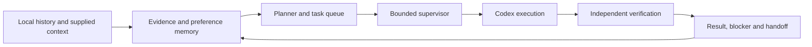

# Alwaysrun

[中文](README.md) · [Architecture](docs/architecture.md) · [MIT](LICENSE)

**A local project supervisor with evidence-backed memory, bounded execution and independent verification, powered by an installed Codex app-server.**

Alwaysrun owns project goals, preference feedback, task state and the control loop. Codex supplies model reasoning and engineering tools. A separate read-only turn verifies completed work before the supervisor records success.

This is a prototype. Automatic execution starts disabled. Offline checks and a single successful execution do not establish eight-hour endurance.



## Quick start

Requirements: **Node.js 24+**, an installed and signed-in Codex CLI, and access to the configured model.

```sh
git clone https://github.com/zxyllebron/alwaysrun.git
cd alwaysrun
node scripts/setup.mjs
node src/server.mjs
```

Open <http://127.0.0.1:8790/>. There are no third-party Node runtime dependencies and no install step is necessary. `npm run setup` and `npm start` are equivalent shortcuts when npm is installed. The UI currently uses Chinese.

On Windows, `Start Alwaysrun.cmd` initializes configuration and runs the server in the background; `Stop Alwaysrun.cmd` stops it. On macOS/Linux, run `npm start` in a terminal and press Ctrl+C to stop.

A clean installation contains no personal projects or inferred preferences. Add a project with a goal, directory and priority. Historical directories remain inactive until explicitly enabled. Supply context and review preference candidates through the UI.

## How it works

- Index visible local Codex messages, supplied text and optional Mystation snapshots, preserving source and author metadata.
- Extract candidate preferences from bounded evidence samples. Accept/reject feedback persists; conflicts remain pending review. No model fine-tuning is performed.
- Plan verifiable tasks for active projects. Prepare useful prerequisites for the first project before switching to another; wait when no useful work is available.
- Execute in the selected project workspace, then verify through a separate read-only model turn and check artifact or successful-command evidence.
- Apply an independent supervisor deadline and persistent invocation/output budgets. Record results, blockers and handoff state in SQLite.

The [architecture document](docs/architecture.md) describes the modules, state transitions and limits.

## Configuration

`npm run setup` creates ignored `data/config.json`. Edit it and restart to change configuration. See the [generic example](examples/config.example.json).

Defaults are `gpt-6.1-sol` with `xhigh`, port 8790 and a disabled nightly schedule. Select a model/effort combination explicitly supported by your Codex account. The client checks the model catalog and does not silently downgrade. If CLI discovery fails, set `codexBin` to its executable or official npm `codex.js` entry point.

Initial configuration can use `ALWAYSRUN_NAME`, `ALWAYSRUN_PORT`, `ALWAYSRUN_MODEL`, `ALWAYSRUN_EFFORT`, `ALWAYSRUN_CODEX_BIN`, `ALWAYSRUN_CODEX_HOME` and `ALWAYSRUN_WORKSTATION_DB`. Existing saved values take precedence. `ALWAYSRUN_DATA` selects a separate data directory. `.env` files are not automatically loaded.

Scheduled windows currently use `Asia/Shanghai` (UTC+8). A manual session counts from its start. Defaults are eight hours, 24 top-level Codex turns and 100,000 reported output tokens. One turn may include many internal model/tool rounds. These are not currency or complete token-billing caps. Keep the host and service awake and connected.

## Optional sources

Set `workstationDb` to a Mystation `data/workstation.sqlite` to read its existing records, tasks and plans. Mail in that database is an existing snapshot, not an independent live Gmail connection.

The optional Feishu adapter reads Bitable tables/records using `FEISHU_APP_ID` and `FEISHU_APP_SECRET` from the local environment. Grant the application access to the resource and add its real `/base/…` URL through the UI. Article URLs, `/wiki/` pages and private chat messages are outside this adapter.

## Privacy and execution

The server binds to loopback, checks Host/Origin and requires a random mutation token. It is not an authenticated internet-facing or multi-user service.

Local state, credentials and personal exports are excluded from Git. Retrieved evidence is sent to the configured Codex model service when a model task runs; local storage does not imply offline inference. Authentication files are not intentionally ingested or copied.

Analysis, planning and verification use read-only mode; execution uses workspace-write. Historical text is evidence, not new authorization. The project has no payment executor, desktop controller, final-submission integration or security-check bypass. See [SECURITY.md](SECURITY.md).

## Checks

```sh
npm run check
npm test
npm run smoke
```

Offline checks use synthetic fixtures. The clean-install smoke exercises startup, HTTP controls, synthetic import/search and shutdown without personal context or model calls. `npm run doctor -- --live` and `node scripts/live-smoke.mjs` are explicit live-model checks and consume model quota.

Before pushing staged public source, run `npm run audit:public`. Do not commit `data/`, `artifacts/`, `.protocol/`, authentication material or personal screenshots. See [CONTRIBUTING.md](CONTRIBUTING.md).

## Limits and license

Eight-hour endurance, currency caps, broad real-world judgment quality and compatibility with every Codex database/app-server version remain unverified. Semantic evidence association and preference interpretation depend on model judgment.

[MIT License](LICENSE). The interface direction is inspired by [Mystation](https://github.com/zxyllebron/codex-feishu-workstation). Integration uses the [official Codex app-server](https://learn.chatgpt.com/docs/app-server). No model weights or Codex login credentials are distributed.
