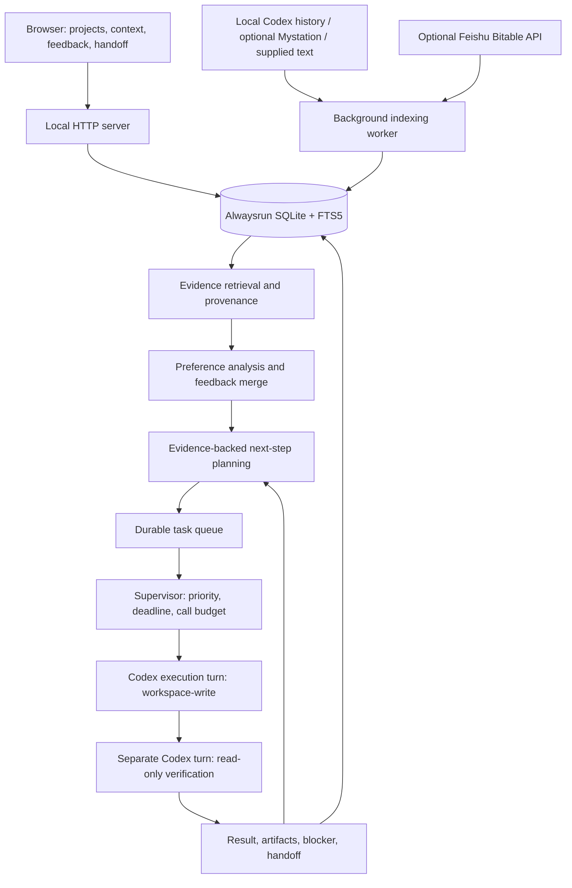
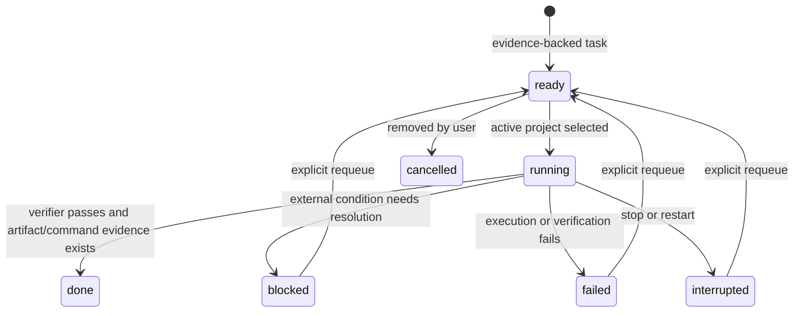

# Alwaysrun architecture

Alwaysrun is an independent, local project supervisor. It owns durable state and the control loop; the installed Codex app-server supplies model reasoning and engineering tools. The browser is a view over that state, so closing the browser does not end a running supervisor.

## Components

| Module | Responsibility |
| --- | --- |
| `src/server.mjs` | Loopback HTTP API, origin and action-token checks, static UI, startup and shutdown. |
| `src/config.mjs` | Local configuration, validation and atomic saves. |
| `src/store.mjs` | SQLite WAL state, FTS5 retrieval, runs, projects, tasks and events. |
| `src/background-context.mjs`, `src/sync-worker.mjs` | Keep source database reads off the HTTP and deadline event loop. |
| `src/context.mjs` | Import visible local messages, optional workstation snapshots and supplied text; associate source copies and authorship. |
| `src/preferences.mjs` | Merge inferred preferences with durable accept/reject decisions and unresolved conflicts. |
| `src/engine.mjs` | Planning, task dispatch, execution, verification, bounded night sessions and handoff. |
| `src/codex.mjs` | Independent stdio app-server client, model catalog validation, structured outputs, tool activity, interruption and usage. |
| `src/feishu.mjs` | Optional, read-only Feishu Bitable table/record pagination. |
| `static/` | Buildless HTML/CSS/JavaScript interface, polling the local state API. |

No third-party Node runtime dependencies are required. Node.js 24 provides SQLite, HTTP, workers and fetch.

## Evidence and memory

Local history indexing reads visible user messages and assistant replies from the Codex SQLite stores. Hidden reasoning, image pixels, authentication files and complete raw tool outputs are outside the importer. Codex database names and schemas are implementation details and may change between releases.

Every indexed document retains an ID, source URI, time and available author metadata. Imported quotations default to an unknown author. Submitting a transcript does not make its author the submitting user. When an original conversation is available, a workstation copy is associated with it rather than counted as independent evidence. Alwaysrun-generated conversations are excluded from its own preference evidence.

A workstation update first reads a complete, read-only source snapshot. Only after success does a transaction update documents, FTS and the content revision together. Shortened content removes trailing chunks. Deleted, stale, dismissed and superseded records leave the index. Failure retains the previous successful snapshot and surfaces an error.

The model receives a bounded retrieved sample, not the entire archive in every call. A quote is mechanically checked for an exact match where possible; this is a citation check, not proof that an interpretation is correct.

Preference learning uses retrieval and persistent feedback; it does not fine-tune model weights. Accepted and rejected interpretations survive rephrasing when linked to their existing IDs. Conflicts remain pending review. Semantic association still depends on model judgment and should be evaluated against real user corrections. Inferred preferences do not grant permissions.

## Codex integration

Alwaysrun launches its own `codex app-server --stdio` process. It reuses the existing Codex login in place, without copying authentication material or resuming the user's desktop chats. It removes inherited desktop session and IPC identity variables from its child environment.

The client initializes the protocol, validates the configured model and effort against the returned catalog, starts an independent thread and submits a turn. It observes tool completion, usage and final output. A service-side model reroute interrupts the turn rather than silently changing the requested model. Windows children prefer the official MXC sandbox option; the global Codex configuration is unchanged.

Discussion, analysis, planning and verification use read-only mode. A task execution turn receives workspace-write access to the selected project. Unsupported tools and native approval requests are recorded as blockers. The supervisor does not implement CAPTCHA bypass, impersonated approvals, payments or desktop control.

## Control loop

Only active projects enter automatic dispatch. Discovered historical directories and paused projects do not. Lower priority numbers run first; prerequisite tasks precede progress tasks at the same priority. A blocked result triggers planning that prioritizes useful preparation for the first project before another project. The usefulness of proposed preparation is a model judgment, bounded by the session limits.

Execution reporting is followed by a separate, read-only model turn. The supervisor additionally checks artifact paths against the project root and records file hashes or successful native command results. This reduces unsupported completion claims, but does not constitute formal verification of arbitrary software.

The supervisor owns the deadline independently of the model. Session call and output budgets persist across midnight; failed calls also consume the invocation budget. A call means a top-level Codex turn, which can contain multiple internal model/tool rounds. Output accounting relies on reported usage; neither limit is a currency or complete token-billing cap.

When planning yields no useful executable work, the supervisor waits without repeatedly calling the model, then checks for source revisions or new tasks. Restart marks unconfirmed work interrupted and does not silently count it as completed or automatically repeat the same scheduled session. Night handoff files are written under ignored `data/reports/`.

Scheduled windows currently use `Asia/Shanghai` (UTC+8). Manual sessions count from the moment they are started. The host and service must remain awake and connected; this prototype is not an operating-system service manager.

## Local state and publication boundary

`data/` contains machine-specific configuration, source indexes, messages, preferences, task state and runtime logs. `artifacts/` contains local verification material. Neither belongs in a public repository. The publication audit checks indexed Git content rather than trusting the current working tree or `.gitignore` alone.

See [security and privacy](../SECURITY.md) and the [configuration example](../examples/config.example.json).

## Validation and remaining work

The offline suite covers reconciliation, rollback, provenance, preference feedback, scheduling priorities, budgets, restart handling and failed independent verification. A separate clean-install smoke uses an empty synthetic environment, exercises HTTP controls and import/search, and makes no model calls.

Long-duration eight-hour endurance, currency caps, broad model-judgment quality and compatibility with all Codex releases are not established by those checks. Live model checks are explicit opt-in commands and use the user's model quota.
